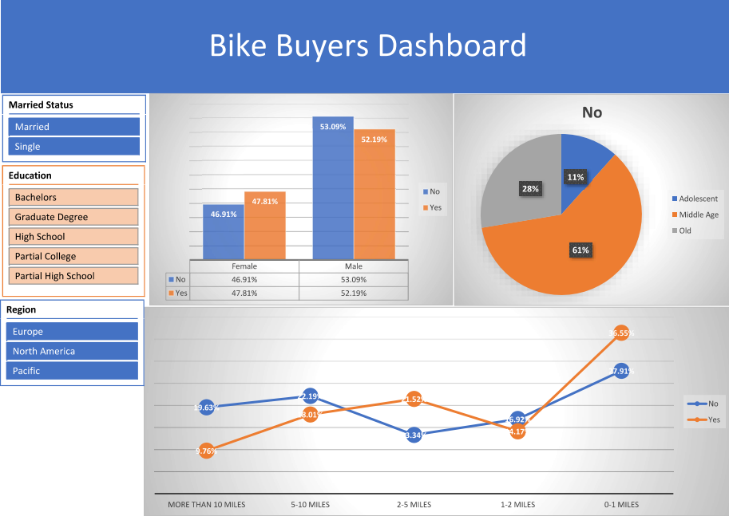
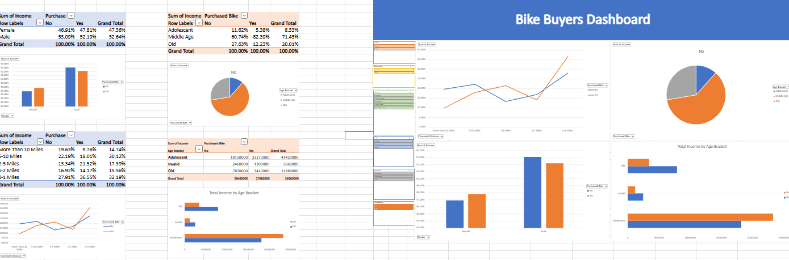

## Bike Buyers Dashboard
- Analyzed a 1,000-customer dataset (12 attributes: income, age, region, education, occupation, commute distance, marital
status, and more) to identify the factors that drive bike purchases.
- Engineered an Age Bracket column with nested IF formulas, built 4 PivotTables, and designed an interactive dashboard with 6
slicers (Age Bracket, Education, Gender, Marital Status, Region, Purchased Bike).

- Key insights:
  1. Overall purchase rate of 48%
  2. Pacific region leads at 59% vs. 43% in North America
  3. Singles buy more than married customers (54% vs. 43%)
  4. Customers commuting up to 1 mile or 2–5 miles convert at 55–59% vs. 30% beyond 10 miles
  5. Ages 31–54 make up about 80% of buyers
---

